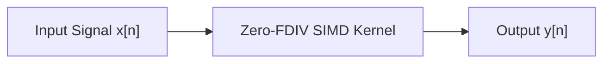

# Normative Specification Template (docs/specs/<domain>/)

Use this template when authoring or extending a normative technical specification under `docs/specs/`. Every specification must start with YAML frontmatter declaring `id`, `title`, `status`, `version`, `domain`, `rule_prefixes`, `requirements`, and active `adrs` (never superseded ADRs). Each normative rule must stand alone on its own line immediately under a `##`, `###`, or `####` heading with a unique `r[<domain>.<subdomain>.<rule>]` identifier and zero skipped heading levels; see the [docs authoring guide](../CONTRIBUTING.md).

This specification defines how the `<Subsystem Name>` operates across `packages/engine/` and `packages/capture/`, fulfilling [`REQ-1.1`](../requirements/system_goals_and_requirements.md). Write in calm, focused technical-manual prose (`<= 650` characters and `<= 8` inline code spans per paragraph) paired with crisp tables, Mermaid diagrams, and monospaced ASCII layouts. Keep design rationales and rejected alternatives in [ADR-0022](../adr/0022-sona-state-space-operator-and-webgpu-architecture.md) rather than narrative essays inside specifications.

---

## 1. `<Subsystem Overview & Signal Flow>`

`r[example.subsystem.signal-flow]`

Open major architectural sections with a Mermaid signal-flow diagram or monospaced ASCII layout, followed by brief explanatory prose. Write domain concepts, frequencies, byte sizes, multipliers, and tier names as plain text ("48 kHz", "64-byte", "2×", "Lite", "SONA"), reserving backticks strictly for code identifiers, types, JSON keys, and rule markers.



```text
+---------------------------------------------------------------------------------------------------+
| 64-BYTE CACHE-LINE STRUCT OR ARENA LAYOUT                                                         |
+---------------------------------------------------------------------------------------------------+
|  [0..15]:  f32x4 state_lane_0  |  [16..31]: f32x4 state_lane_1  |  [32..63]: 32 B alignment pad   |
+---------------------------------------------------------------------------------------------------+
```

### 1.1 `<Section-Level Normative Rule>`

`r[example.subsystem.recurrence]`

State the exact mathematical recurrence, bit-level wire layout, or state transition law in clear prose and display math:
$$y[n] = \alpha x[n] + (1 - \alpha) y[n-1], \qquad \alpha \in [0, 1]$$

#### 1.1.1 Cold-Path Coefficient Preparation

`r[example.subsystem.cold-path-prep]`

Specify exact rounding modes (such as round-to-nearest, ties-to-even RNE), concrete primitive types (`f32`, `f64`, `u128`), and admission checks executed outside the real-time audio loop. Use short parallel bullet lists (`<= 240` characters and `<= 5` code spans per item) only when listing parallel items; use prose paragraphs or tables for multi-sentence rules.

#### 1.1.2 Real-Time Loop Execution (Zero FDIV, FSQRT, or libm)

`r[example.subsystem.realtime-loop]`

Specify the branchless per-sample (48 kHz) or control-tick (3 kHz) operations and clamped state bounds. Never start Markdown link labels with `../` or `./`; always use human-readable titles or basenames.

| Parameter / Field | Type & Domain | Normative Invariant |
| :--- | :---: | :--- |
| `alpha` | `f32` in `[0.0, 1.0]` | Precomputed on cold path; zero real-time division (`ref[repo.docs.markdown-table-math]`: no raw dollar signs in tables). |
